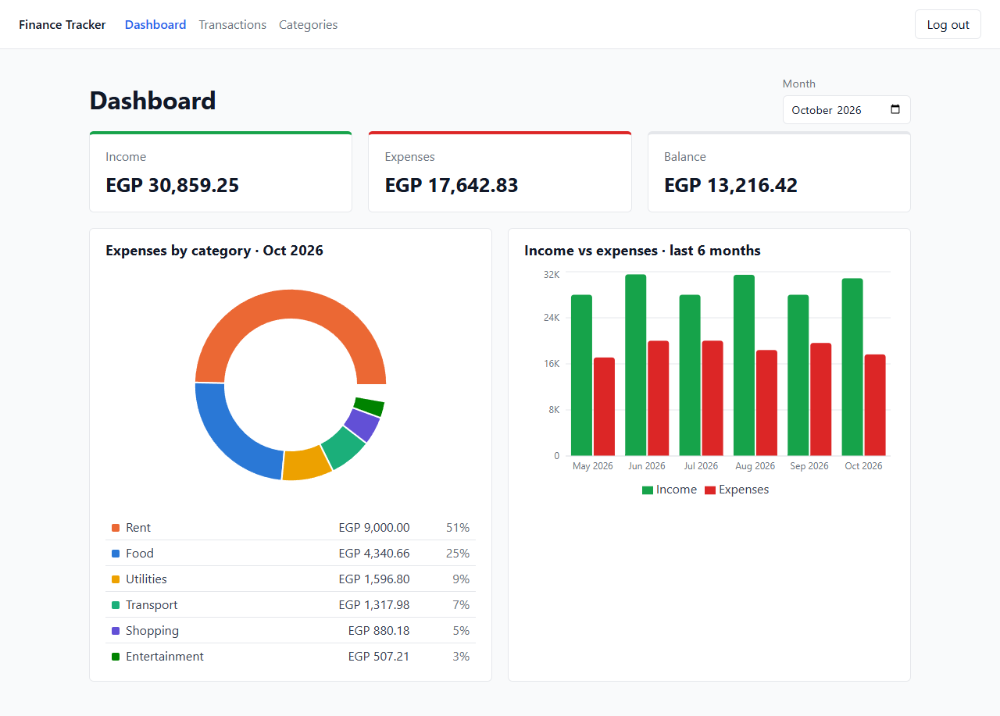
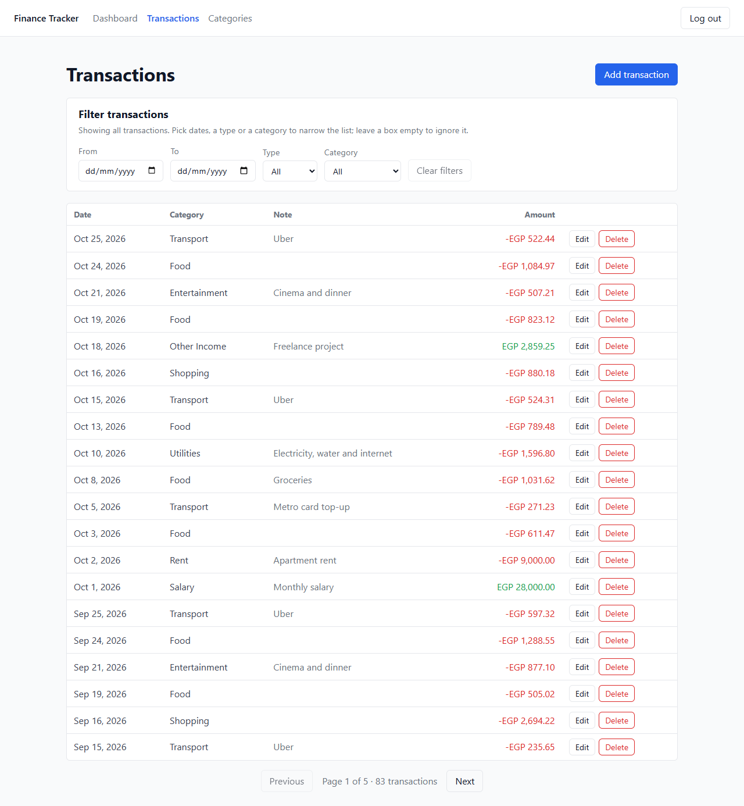
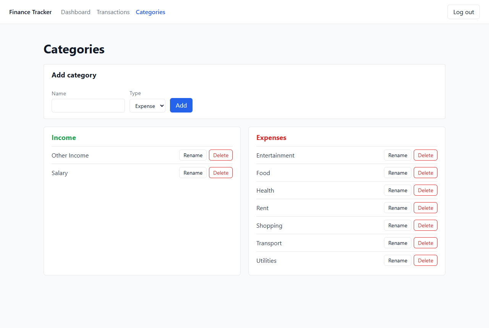
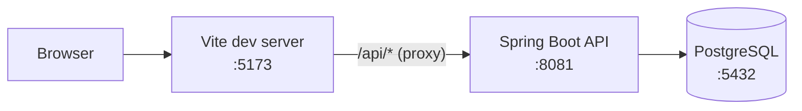

# Finance Tracker


A personal finance tracker: record your income and expenses, organise them into categories, and see monthly totals
and charts. A Spring Boot REST API, a React + TypeScript single-page app, and a PostgreSQL database.

## Features

- **Accounts:** register with email and password, log in with a JWT that lasts 8 hours. Every user has a private
  ledger; asking for someone else's data returns 404, as if it doesn't exist.
- **Categories:** each new account starts with default categories (Salary, Other Income, Food, Rent, Transport,
  Utilities, Health, Entertainment, Shopping). Create, rename and delete your own; each is either `INCOME` or
  `EXPENSE`. A category that still has transactions can't be deleted, so no data is orphaned.
- **Transactions:** record an amount, date, category and optional note; edit and delete them. Whether it's income or
  an expense comes from its category. The list is paged, newest first, and can be filtered by date range, category
  and type.
- **Dashboard:** pick a month to see total income, total expenses and balance, a donut chart of expenses by category,
  and a bar chart of income vs expenses over the 6 months ending with the chosen month.

Amounts are shown in Egyptian pounds (EGP).

## Screenshots

**Dashboard:** monthly summary, expenses by category, and income vs expenses over six months.



**Transactions:** filter by date range, type and category; paged, newest first.



**Categories:** income and expense categories, with the defaults every new account starts with.



## Tech stack

| Layer    | Technology |
|----------|------------|
| Backend  | Java 21, Spring Boot 4.1 (Web MVC, Data JPA, Validation, Security + OAuth2 Resource Server for JWT), Maven |
| Database | PostgreSQL 17 (Docker), schema managed by Flyway |
| Frontend | React 19, TypeScript, Vite, React Router 7, Axios, Recharts, plain CSS |
| Testing  | JUnit 5, MockMvc, Testcontainers |

## Architecture



- **Backend** (`backend/`): packages are organised by feature (`auth`, `category`, `transaction`, `dashboard`), plus
  `user` and `common` (exception handling, paging, current user). Each feature is layered
  controller → service → repository, and the API only ever returns DTOs, never JPA entities.
- **Database:** Flyway migrations in `backend/src/main/resources/db/migration` own the schema; Hibernate only
  validates that the entities match it.
- **Security:** stateless JWT (HS256). `/api/auth/register`, `/api/auth/login` and `/api/health` are public;
  everything else needs `Authorization: Bearer <token>`. Every query is scoped to the logged-in user.
- **Frontend** (`frontend/src/`): folders mirror the backend features (`auth`, `categories`, `transactions`,
  `dashboard`). All HTTP calls go through one axios instance (`api/client.ts`) that attaches the token and sends you
  to `/login` when the API answers 401.

## Getting started

### Prerequisites

- JDK 21
- Node.js 20.19+ or 22.12+ (with npm)
- Docker (for the database, and for the backend tests)

### Run it locally

1. **Start the database** (from the repo root):
   ```bash
   docker compose up -d db
   ```
2. **Start the backend** (serves on http://localhost:8081):
   ```bash
   cd backend
   ./mvnw spring-boot:run        # Windows PowerShell: .\mvnw.cmd spring-boot:run
   ```
   Flyway creates the tables on first start.
3. **Start the frontend** (in a second terminal):
   ```bash
   cd frontend
   npm install
   npm run dev
   ```
4. Open the URL Vite prints (usually http://localhost:5173), register an account, and start adding transactions.

### Configuration

Set these environment variables to override the defaults in `backend/src/main/resources/application.properties`:

| Variable      | Default                                       | Purpose |
|---------------|-----------------------------------------------|---------|
| `DB_USERNAME` | `finance`                                     | Database user |
| `DB_PASSWORD` | `finance`                                     | Database password |
| `JWT_SECRET`  | a development-only value                      | Key that signs tokens; at least 32 bytes. **Set your own anywhere outside your machine.** |

The database URL (`localhost:5432/finance_tracker`), API port (`8081`) and token lifetime (`PT8H`) are set in the
same file.

## API

All routes are under `/api`. Request and response bodies are JSON.

| Method | Path | Description |
|--------|------|-------------|
| `GET`  | `/api/health` | Health check (public) |
| `POST` | `/api/auth/register` | Create an account (public); password 8–72 characters with a digit and a special character |
| `POST` | `/api/auth/login` | Log in, returns a JWT (public) |
| `GET`  | `/api/auth/me` | The logged-in user |
| `GET`  | `/api/categories` | List your categories |
| `POST` | `/api/categories` | Create a category (`name`, `type`: `INCOME` or `EXPENSE`) |
| `GET`  | `/api/categories/{id}` | Get one category |
| `PUT`  | `/api/categories/{id}` | Rename a category |
| `DELETE` | `/api/categories/{id}` | Delete a category (409 if it still has transactions) |
| `GET`  | `/api/transactions` | Paged list; optional `from`, `to` (`yyyy-MM-dd`), `categoryId`, `type`, `page` (default 0), `size` (default 20, max 100) |
| `POST` | `/api/transactions` | Create a transaction (`categoryId`, `amount`, `date`, optional `note`) |
| `GET`  | `/api/transactions/{id}` | Get one transaction |
| `PUT`  | `/api/transactions/{id}` | Update a transaction |
| `DELETE` | `/api/transactions/{id}` | Delete a transaction |
| `GET`  | `/api/dashboard/summary?month=yyyy-MM` | Income, expenses and balance for a month (default: current month) |
| `GET`  | `/api/dashboard/expenses-by-category?month=yyyy-MM` | Expense total per category for a month |
| `GET`  | `/api/dashboard/monthly?month=yyyy-MM&months=12` | Income vs expenses per month, ending at `month` (max 24 months) |

Errors use the standard [Problem Details](https://www.rfc-editor.org/rfc/rfc9457) format. A validation error (400)
also has an `errors` object with one message per invalid field:

```json
{
  "title": "Bad Request",
  "status": 400,
  "detail": "Validation failed",
  "errors": { "amount": "must be greater than 0" }
}
```

## Testing

```bash
cd backend
./mvnw test
```

This runs unit tests for the services and integration tests that call the API through MockMvc against a real
PostgreSQL started by Testcontainers, so **Docker must be running**.

The frontend has no test runner; check it with:

```bash
cd frontend
npm run lint    # ESLint
npm run build   # type-check with tsc, then production build
```

## Project structure

```
finance-tracker/
├── backend/              Spring Boot API (Maven)
│   └── src/main/java/com/youssef3b4afi/financetracker/
│       ├── auth/         register, login, JWT, security config
│       ├── category/
│       ├── transaction/
│       ├── dashboard/    totals and chart data
│       ├── user/
│       └── common/       error handling, paging, current user
├── frontend/             React + TypeScript SPA (Vite)
│   └── src/              auth/, categories/, transactions/, dashboard/, api/, components/
├── docs/                 user stories, frontend build plan, screenshots
└── docker-compose.yml    PostgreSQL for local development
```

## Roadmap

The MVP user stories in [`docs/user-stories.md`](docs/user-stories.md) are all done. Ideas for later:

- Budgets per category
- Multiple accounts and transfers between them
- Recurring transactions
- CSV import and export

## License

[MIT](LICENSE) © 2026 Youssef Mohamed Abdelshafee
